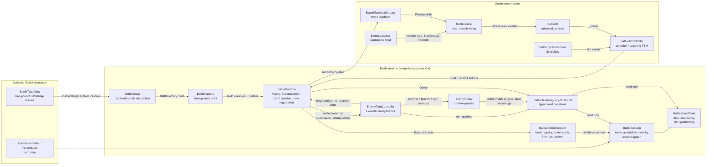

# Battlescape Tactical Runtime Architecture

The tactical runtime is scene-independent C# in `scripts/battle/`. It is the single source of truth for live battle state. Godot scenes read its state and play committed events.

Detail: [battle-action-executor.md](battle-action-executor.md) (execution rules), [battlescape-tile-system.md](battlescape-tile-system.md) (board, LOS, and paths), [battle-map-authoring.md](battle-map-authoring.md) (map authoring).

## Design Goals

- `BattleSession` owns all live tactical state.
- `BattleAction` values are the only gameplay-initiated writes. `BattleActionExecutor` resolves them.
- `BattleRuntime.Query` runs typed `IBattleSessionQuery<TResult>` objects for read-side questions.
- Scenes own presentation, input, and playback. They read through queries and react to committed events.
- Board coordinates are the engine-agnostic `FunProject.Core.Vector3I` (X = width, Y = levels, Z = depth). Authored resources use Godot's `Vector3I`. The runtime boundary converts.

## Runtime Diagram



## Ownership Rules

- `BattleSession` owns: completion (`Option<BattleOutcome>`), turn number, active side, faction order, unit pool, and alive/dead storage. It also owns the round queue, current-turn availability, per-faction visibility and explored memory, capture membership, and event emission. The UI owns unit selection.
- `BattleBoardState` owns: tile storage, walkability and occupancy, adjacency, occupant placement, movement, removal, and board-local pathfinding.
- `BattleAction` owns action-specific legality checks and application. A composite action unfolds into primitives.
- `BattleActionExecutor` owns: the hook registry (default systems register in its constructor), `RegisterHook`/`UnregisterHook`/`Dispose`, the pending action stack, invocation order, and interrupt capture. A failed submission clears queued work and propagates the exception. Committed state and events remain.
- `BattleRuntime` owns: the public methods `Query` and `ExecuteAction`, the proof methods `TryGetAlive`/`TryGetAliveObject`/`TryGetAttackTarget`/`TryGetTile`, the `RegisterHook`/`UnregisterHook` facade, the session's single executor, and one `_enemyController` initialized with the runtime. It re-raises `BattleEventCommitted` and raises `ActionStarted`/`ActionCompleted`.
- `IBattleSessionQuery<TResult>` implementations each own one question and its result shape.
- Unit inventory belongs to `BattleUnitState`.
- `BattleLauncher` resolves a `BattleTypeData`, starts the runtime, loads `BattleScene.tscn`, and calls `Present`. `BattleScene` holds the runtime and setup and instances the pooled `BattleMap`. It builds `EventPlaybackDirector`, `BattleUnitMeshes`, `BattleUiController`, and `BattleInputController`. It pushes view models into the authored `BattleUI` view.
- `BattleUiController` owns the selection and targeting FSM and turns intents into queries and submitted actions. `BattleInputController` raycasts tiles and emits `TileClicked`/`TileHovered`/`ConfirmPressed`/`CancelPressed`. `EventPlaybackDirector` subscribes to `ActionCompleted`, plays each result's committed events in commit order (coalescing consecutive move events), and raises `PlaybackIdle`. They use runtime queries and submitted actions for tactical reads and writes.

## Runtime Components

### Battle startup

`BattleFactory` is the production entry point. `Start(type, seed?, playerDeployment?)` resolves the setup and starts it. `Start(setup, hitChance?)` is the single startup routine:

1. `BattleSetupResolver.Resolve` picks a map from `BattleTypeData.MapPool` with the seed. It probes the chosen `BattleMap` scene for its `MapData`. It builds ordered sides with positioned units. Resolver failures are typed `BattleSetupFailure`s: `EmptyMapPool`, `MapSceneInvalid`, `UnknownFaction`, deployment faction mismatches, and `SpawnSlotShortfall`.
2. `Start(setup)` validates the designated player before creating a fresh board: a player faction outside the sides returns `UnknownFaction`, and a player side with zero deployed units returns `EmptyPlayerDeployment`. Playerless setups remain supported. It then parses and validates the complete layout before any side effect. The layout check covers objectives and duplicate, unavailable, or overlapping unit/object cells.
3. The complete roster and objects materialize on the board, and the objectives instantiate. The factory then constructs the session with its scheduler already valid. The initial round queue, active side, and availability come from the real roster. A roster without an eligible first faction is a construction failure. The factory adds the runtime and its default hooks.
4. Declared systems register through the narrow `BattleHookRegistration` capability. The capability carries no runtime handle, queries, or submission. The single private factory-owned bootstrap runs after registration.
5. The bootstrap announces the initial placements, `SessionStarted`, and the first turn through the ordinary event dispatch. Every placement announcement precedes the initial spotting announcements. Hooks see the complete roster and availability. Session start precedes the first turn and its AP refresh while the battle is ongoing. Interrupts run only after the startup primitive. The factory owns all setup.
6. An initialization fault before the runtime exists throws before anything registers. A fault after construction disposes the runtime and rethrows the original exception. A start whose terminal objective ends the battle during startup succeeds and returns the completed runtime.

`BattleSetupResolver.Resolve` also accepts a `SideDeployment` for a generated mission enemy force. Deployment stat modifiers enter through `UnitLoadout.StatMods` and contribute exactly once at spawn, in the order defined by [stat folding](stat-system.md#effective-stat-access).

A supplied `PlayerDeployment` keeps its exact campaign faction and combatant references. `Combatant.OwningFaction` stays unchanged. A mismatch is a typed failure. Campaign launch and return are implemented; see [campaign lifetime](strategic-runtime.md#capture-and-campaign-lifetime). `BattleLauncher` starts the standalone battle and presents `BattleScene` the same way.

### BattleSession

The session is turn scheduling, state, and event dispatch. It owns unit ids, alive/dead moves, faction elimination, and the round queue. It also owns action-point (AP) availability for the active side, visibility refresh, and the draw resolution at turn end. Its scheduler establishes the initial round queue, the active side (the first faction with a conscious unit), and availability at construction. A roster with no conscious faction fails construction.

Read battle state through typed queries via `runtime.Query(...)`. Actions and queries use internal session helpers. Scenes and AI depend on the runtime's public surface.

Event dispatch processes a guarded queue. Each broadcast first refreshes visibility and invalidates affected action-option availability, then invokes `BattleEventCommitted`. An event raised mid-dispatch waits until the current event finishes (breadth-first). A throwing hook clears the queue and reports the exception. The session announces. The executor reacts.

### Life, incapacity, and conscious forces

- `IsAlive` is `CurrentHealth > 0`. `IsDead` is zero health.
- `IsUnconscious` is `IsAlive && CurrentStun >= CurrentHealth`.
- `IsIncapacitated` is `IsDead || IsUnconscious || IsImmobilized`.
- Acting requires positive AP and a capable actor, plus the session's turn and availability checks (`CanUnitActNow`).

`AliveUnit` proves life and board presence, including unconscious bodies. Bodies stay in alive storage on their tile, block occupancy, and remain targetable. Damage actions can affect them. Faction elimination and scheduling count living conscious units, independent of AP or temporary immobilization. Health-based survivor summaries keep unconscious participants alive.

### Damage, disabling, and recovery

`DamagePacketData.Kind` and runtime `Damage.Kind` default to `Health`; mixed health/stun bundles preserve kind through modifiers. Stun starts at zero. `Damage` packets carry amount, element, and kind. `DamageResolver` (`scripts/battle/combat/`) resolves them in bundle order inside `ApplyDamageTo`:

- Health packets consume remaining armor. An element match removes 1.5× armor (floored). Health spill uses the original packet amount.
- Stun packets bypass armor, leave it for later packets, and increase only `CurrentStun`.
- Non-positive packets resolve to zero.

`DamageResolution` and `UnitDamagedBattleEvent` carry separate `ArmorDamage`, `HealthDamage`, and `StunDamage` totals; the event also carries the pre-mitigation bundle. Death emits `UnitKilledBattleEvent`. A new unconscious transition emits `UnitUnconsciousBattleEvent`. Other hits emit `UnitDamagedBattleEvent`.

A lethal bundle emits only the kill event, including death after earlier unconsciousness. Kill credit is death-only. Elimination objectives observe both event types. Death playback and kill-only hooks keep consuming `UnitKilledBattleEvent`.

Status effects (`StatusEffectSpecData` in `scripts/items/effects/`) apply after survival. Each packet uses its own `ApplyChancePercent` and `RequiresHealthDamage`. A health-damage requirement needs positive health spill from that packet. `StatusEffectSystem` ticks at the owner's turn end: decrement, damage-over-time through the normal pipeline, expiry.

Recovery order at the ending faction's turn end: `StatusEffectSystem` and `ArmorRegenSystem` (priority −100), then `StunRecoverySystem` (priority −90). Only armor or health damage restarts the armor regen delay. In-progress battles recover up to `5u` stun per owner turn for living conscious units. A positive reduction raises `UnitStunRecoveredBattleEvent`. Routing max-health debuff effects through the damage pipeline is deferred.

### Buffs

The buff system uses shared `Buff`/`BuffCondition` resources in `scripts/buffs/`. `BattleUnitState` stores an ordered `(Buff, IsActive)` entry per grant and owns evaluation.
- Grants at spawn come from `Combatant.InnateBuffs` plus `BuffGrantCapabilityData` on equipped weapon/armor. Identical grants stack. Hooks re-evaluate post-broadcast (`TurnStartBuffHook`, `UnitSpawnedBuffHook`). Turn-start flips apply before the AP refresh.
- Each flip caps current health at the new maximum, with a minimum cap of 1. It raises the activation event before the next grant.
- Active snapshots feed `StatMod`s through `GatherStatContributions` and `DamageBundleMod`s through `TrySpendShot` after slot and ammunition mods. The unit owns activation state for the shared resources.

### Board objects

`BattleObjectState` is an immovable placed object. Attackable objects carry `ObjectHealthCapability`. `BattleEntity` carries a unit or object identity. `BattleRuntime.TryGetAttackTarget` creates its `AttackTarget` proof. The proof is `Some` only for a live unit or a live health-bearing object.

Feasibility (weapon, self, ally, liveness, attackability, visibility, range) resolves once through `AttackContext.Resolve`. `AttackEntity` and the `GetHitChanceForAttack` preview share this check, so both callers use the same feasibility rules. Against a unit, the attack rolls through the session's `IHitChanceCalculator` (default `StandardHitChanceCalculator`: Aim − cover, clamped 0–100) with the seeded RNG. Against an object, the attack skips the calculator. A feasible object shot always connects. `weapon.TrySpendShot(attacker.ActiveBuffDamageMods)` spends ammo before the roll; a missed shot consumes ammunition.

Object damage goes through `ApplyDamageTo`'s object overload. Health packets reduce the capability. The overload ignores stun and status payloads. Zero health is the terminal `Destroyed` transition. Occupancy clears before the broadcast. Objects emit `ObjectDamagedBattleEvent` and `ObjectDestroyedBattleEvent`.

Timed objects carry `TimedEffectCapability`. `SpecialObjectTimerSystem` expires them at turn end and resolves payloads before `ObjectExpiredBattleEvent`. `TimedObjectObjective` fails the mission when a tracked timed object expires or is destroyed.

Area effects resolve through `CapabilityEffectResolver`. A blast hits every unit and every live health-bearing object in the radius. Friendly fire is included. The blast uses the ordinary damage pipeline.

### Capture summary and campaign lifetime

The first `EndBattle` freezes capture membership before broadcasting `SessionEndedBattleEvent`. Victory with a designated player captures every living unconscious enemy. The rule covers every cause of the unconscious state.

The list is read-only and deduplicates original `Combatant` references. The Combatants keep their identity and faction. Roster membership stays unchanged. `GetFactionEndOfBattleSummary` exposes `CapturedEnemies` only for that player's victory summary. Unconscious player participants remain survivors.

`GameState.Captivity` retains added Combatants by reference for the campaign's lifetime, deduplicates by reference, and returns detached snapshots. `GeoscapeSession.CompleteMission` transfers captured identities to campaign captivity and removes reported deaths from the roster. See [campaign lifetime](strategic-runtime.md#capture-and-campaign-lifetime).

### IBattleSessionQuery

```csharp
public interface IBattleSessionQuery<out TResult>
{
  public TResult Execute(BattleSession session);
}
```

The result shape is part of the contract:

- Bare `TResult` — the question always has an answer, usually because proof-typed inputs (`AliveUnit`, `ValidatedPoint`) carry the invariants. `CanUnitActNow` takes a raw `BattleUnitState` because `false` is a valid answer for any unit, including after completion.
- `Option<T>` — absence is normal (`GetUnitAtTile`, `GetObjectivesForFaction`).
- `Either<BattleQueryFailure, TResult>` — fallible (`GetHitChanceForAttack` for an out-of-range or unseen target, `GetFactionEndOfBattleSummary` before the battle ends).

Scene code creates proofs at the runtime boundary: `TryGetAlive(unit)`, `TryGetAliveObject(obj)`, `TryGetAttackTarget(entity)`, and `TryGetTile(coordinates)`. Missing or dead units and off-board tiles return `None` as expected absence at the proof boundary. Passing a proof into an invalid context is a caller bug. Let the guarding exception propagate, per the trusted-core convention. A `TryGetTile` proof remains valid because board bounds stay fixed.

Examples: `FindPathForUnit`, `GetPossibleMoveTilesForUnit`, `GetVisibleEnemiesForUnit`, `CanUnitActNow`, `GetHitChanceForAttack`, `GetAvailableActionsForUnit`, `GetPlayerFactionQuery`, `GetFactionEndOfBattleSummary`. Use one question per query. Keep the algorithm in that query's implementation. Keep query classes single-purpose, without enum modes, nullable selector fields, or behavior controlled by unrelated properties. Put a complex or variable algorithm in a strategy behind that specific query. Keep each `BattleRuntime.Query` call mapped to one query implementation.

### Query results and action availability

Guaranteed reads remain valid after completion: the outcome is present, the scheduler retains its last active side, and `CanUnitActNow` returns false.

`GetAvailableActionsForUnit` returns a persistent read-only list for that unit identity. The list and its `UnitAction` objects remain live across submissions; they are not detached snapshots. Committed events invalidate relevant conditions before observers run; failed submissions also invalidate availability. Reads during a submission evaluate current state without replacing the retained cached values.

### BattleBoardState

The board stores a flat materialized `BattleTileState[]`, unit and object occupancy, and positions. Cells use the index `x + width * (z + depth * y)` (X width, Y height, Z depth).

Adjacency has eight horizontal directions and two vertical directions; vertical steps have no diagonals. A diagonal step needs at least one open flank. Pathfinding is a pure-C# breadth-first search with a fixed direction order; the board exposes it as `FindPath`. Unit-specific questions stay in queries (`FindPathForUnit`, `GetPossibleMoveTilesForUnit`). See [battlescape-tile-system.md](battlescape-tile-system.md).

### Visibility

The session owns visibility because it derives from unit positions, tile state, and explored memory:

- `VisionStat` is the sight range of each living conscious observer.
- Visible tiles come from scanning a 3D bounding box within Euclidean range and raytracing line of sight per candidate. Whole-tile `BlocksLineOfSight` occludes. A diagonal between two blockers passes only when at least one flanking tile is open. Tiles with `BlocksVerticalLineOfSight` block vertical passages.
- A unit is visible when it stands on a visible tile. Each unit stores its visible tiles and visible units; each faction stores explored-tile memory.
- A faction always knows its own living units. Conscious observers contribute faction vision and can see unconscious bodies. Exploration persists.
- After each committed event, only units whose cell or consciousness changed recompute visible tiles. Every conscious observer rebuilds visible-unit membership wholesale.

`BattleObservationHistory` retains faction-specific terrain and last-seen contacts. `GetFactionUnitKnowledge` returns detached current observations and remembered contacts not currently visible; `GetFactionLastSeenContacts` exposes the history. Hidden current occupancy or an unseen unit's new state must not be inferred from these records. See [knowledge-aware movement](battlescape-tile-system.md#exact-world-and-faction-knowledge-queries).

Vision is omnidirectional. Smoke attenuation and lighting-dependent vision remain deferred.

### BattleAction and the executor

The built-in actions are `SpawnUnit`, `MoveUnit` (composite), `InteractWithObject`, `AttackEntity`, `ReloadWeapon`, `ThrowItem`, `UseItem`, `ApplyDamage`, `PassUnit`, and `EndFactionTurn`.

```csharp
var result = runtime.ExecuteAction(BattleAction.MoveUnit(unit, [destination]));
```

`Submit` and the `ExecuteAction` facade resolve the chain first. They return one `BattleActionExecResult`. The result holds the submitted action plus every event committed while resolving it. The span is a zero-copy `ReadOnlySpan<BattleEvent>` into the executor's append-only log. An interrupted action or a battle that ends mid-submission leaves the remaining steps unexecuted.

`Submit` converts only a `Result.Rejected` step to `InvalidOperationException` because parameters are trusted. The executor clears queued work first. Arbitrary action or hook exceptions then propagate unchanged. Committed state and events remain. Full rules: [battle-action-executor.md](battle-action-executor.md).

## Turn Flow Notes

- The factory constructs the session from the complete initial roster. Its scheduler establishes the first round queue, the active side, and availability at construction. The factory-owned bootstrap announces the placements, `SessionStarted`, and the first turn through the ordinary event machinery. `SpawnUnit` is the in-game reinforcement operation.
- The scheduler skips a declared faction with no conscious unit when it selects the active side. A roster with no conscious faction at all fails construction.
- `ActiveSide` identity is a scheduler-owned fact the session exposes. The session owns `TurnNumber`.
- `EndFactionTurn` is the explicit faction-turn action.
- Turn start follows the same dispatch-then-refresh shape at both invocation sites (the factory bootstrap's first turn and subsequent side turns). Both sites raise the turn-start events (`TurnStarted`, plus `ActiveSideChanged` on a side flip or `SessionStarted` on battle start). Then they refresh action points with `RefreshForNewTurn`.
  - The factory establishes the first turn's scheduling state (round queue, active side, availability) at construction. Each subsequent side turn runs one scheduler `Advance()` after the turn-end dispatch and its outcome check. Exhaustion clears availability and resolves the draw. A reported new round increments `TurnNumber` once.
  - `ActiveSideChanged`/`TurnStarted` observers see the new active side with its availability already established and the round number already applied.
  - The initial AP refresh covers all living units. Later refreshes cover only the turning faction's living units. Both sites skip the AP refresh when the dispatch already decided the battle.
  - Buff evaluation is an ordinary hook on `TurnStartedBattleEvent` (`TurnStartBuffHook`) and on `UnitAddedBattleEvent` at spawn (`UnitSpawnedBuffHook`). The executor's constructor registers both hooks. Dispatch fires them after the event's broadcast. A buff flip applies during the dispatch. For turn start, the flip applies before the AP refresh. That refresh runs once the dispatch completes and reads (possibly buffed) `MaxActionPoints`.
  - Mid-dispatch observers of `SessionStarted`/`TurnStarted` see pre-refresh action points. This is deliberate. When the battle is still ongoing, the refresh always completes before the submission returns.
- `PassUnit` ends a unit activation and currently advances the turn automatically if that side has no remaining actable units.
- Unit death updates alive/dead storage, board occupancy, current-turn availability, and faction queue membership through session bookkeeping. Unconsciousness consumes availability and removes the faction from future turns when no conscious ally remains, while preserving the body and its occupancy. A disabled active faction keeps its current queue head until explicit turn end.
- The designated player's loss of all conscious units ends the battle as defeat. `ObjectiveSystem` suppresses directives on that death or unconscious event, so the player-wipe defeat rule keeps priority over objective results. In a battle with no designated player, the loss of all living conscious units stays in progress until turn end resolves a draw.

## Enemy turns

`BattleRuntime` owns one `EnemyTurnController` and advances successive enemy factions. Automation is always configured with the demo settings `(200, 25, 100, 75)` when a player faction is designated; playerless simulations stay under manual control. The controller executes units within the faction supplied by the runtime. Controllers for different factions are not separate objects.

The execution flow is synchronous:

1. `ExecuteAction` calls the runtime's internal `ExecuteSingleAction` for the initiating action.
2. That method raises `ActionStarted`, submits to the executor, resolves all interrupts, and finishes every `ActionCompleted` observer. It releases the submission guard and returns without calling AI.
3. The public `ExecuteAction` then calls `ExecuteNonPlayerTurn`. Before each faction, it checks disposal, outcome, permanent controller shutdown and the settled active side. It passes an enemy side to `ExecuteEnemyActions` until player control returns. Factory bootstrap uses the same external submission boundary for an initially active enemy.
4. The policy returns an ordinary action built from the proofs used in that decision. The controller immediately calls `runtime.ExecuteSingleAction` directly. This produces ordinary start/completion notifications and cannot reenter the outer handoff.
5. The controller owns successive unit actions within that faction. It queries fresh actable actors in ID order and records the selected actor's current position before every decision, and submits ordinary `EndFactionTurn` when none remain. This includes reinforcements made available by an earlier action. After each submission and its observers, it checks shutdown, outcome and faction change. Each controller call starts fresh activation memory. No activation latch or execution flag is needed. Public `ExecuteAction` returns only the initiating action's result.

The runtime's `_submitting` flag rejects synchronous submission from action callbacks. It spans one submission and its start/completion observers, not the enemy loop. This prevents recursive mutation before later observers have consumed the result; it is not a thread lock. The executor's existing admission checks cover disposal and terminal outcomes, not this callback boundary.

### Policy queries and knowledge

`EnemyPolicy.DecideAction(runtime, faction, memory, actor)` uses ordinary runtime queries directly. The controller supplies the actor; the policy reads actor-visible hostiles and faction last-seen history, without projecting the board or building a decision frame. Visibility and remembered terrain are policy choices; the AI has no separate query-access restriction. Live unit, weapon and proof reads stay within the current decision. Activation memory retains unit IDs, visited coordinates, dismissed contact revisions and failed intents. The policy returns the selected detached intent and an ordinary action using its current actor and target proofs; it keeps no candidate list or diagnostic history. The controller submits immediately, before any callback or state mutation. Actions still recheck facts that start observers or interrupts can invalidate; proofs are never retained for another decision.

The controller selects the lowest-ID actable own unit. The policy considers attacks against all hostiles currently visible to that actor, excluding unconscious units, ten adjacent cells (eight horizontal and two vertical), and one empty-magazine reload. Moves require observed-clear occupancy/terrain; a diagonal requires at least one observed-clear flank. Unknown cells are never probed. Preview uses ordinary attack feasibility/hit calculations without spending ammunition or random rolls, and runs only for the chosen actor. Terrain reads are cached for that actor's cell and at most ten neighboring cells, including diagonal flanks. Frontier scoring checks explored membership in adjacent cells, without reading their terrain. Neither step scales with board area.

The goal is the nearest visible hostile, otherwise the most recently seen unresolved contact, otherwise an adjacent unexplored frontier. Passing on a score plateau is allowed; eventual exploration is not guaranteed. The controller records fresh actor positions before each decision to avoid revisits. The policy dismisses contacts whose remembered cells are currently visible while that unit is absent. Currently visible units, including unconscious hostiles, are filtered out of remembered goals. Dismissal includes the visibility revision, so a later sighting can become a goal again. An empty interrupted result marks its intent failed, preventing repeated submissions that spend no AP. A later action that commits events clears failed intents, so an interrupted attack can be reconsidered after reloading. Unrelated silent mutations from completion callbacks do not cause immediate retries. Turn changes replace the memory. This is retry avoidance, not a combat suppression mechanic.

### Settings and scoring

Settings are percentage-valued floats: `100.0` means 100%. Aggression, caution and range weight allow 0..200 (default 100); preferred range allows 0..100 (default 75). Inputs clamp to those ranges with `Math.Clamp`; constructor defaults apply when settings are omitted. The bomb-defusal demo uses aggression 200, caution 25, range weight 100, preferred range 75; each grunt receives its own fresh loaded service pistol.

Score in points is `60*A*D + 100*A*K - 35*C*E + 20*B*R + 20*P + 8*F + 15*L - 2`, where A/C/B are the corresponding weights divided by 100:

| Feature | Meaning |
| --- | --- |
| D | Hit probability times useful nominal health/stun damage divided by observed remaining health, capped at one |
| K | Hit probability of a nominal health kill |
| E | Geometric exposure from known cover and distance, without enemy equipment or hidden information |
| R | Improvement toward the preferred weapon range |
| P | Progress toward the current goal |
| F | Adjacent unexplored-frontier gain |
| L | Empty-magazine reload |

Candidate measurements are local values; there is no feature-container DTO. The scoring helper and weights live in `EnemyPolicySettings`. Normalized measurements round to hundredths away from zero. Float weights are promoted to double before multiplication, and only the final score rounds to centipoints away from zero; fractional weights are not rounded beforehand. The integral unweighted terms use long intermediates. Default D=.25 and E=.10 with other features zero gives 9.50 points. Only positive candidates are admitted; ties order attack, reload, move, then target ID or destination X/Y/Z. Otherwise the actor passes.

### Termination and lifecycle

There is no action-count cutoff. Move, attack and reload spend ordinary AP; completed passes consume unit-activation availability. Empty interrupted intents are excluded until a later committed action or turn reset. When no own unit can act, the controller submits ordinary `EndFactionTurn`. `PassUnit` is non-interruptible for all callers: it ends an available activation without checking capacity, and no AI-specific pass workaround is needed. Stale or unavailable activation parameters remain caller errors. `EndFactionTurn` cannot return `Interrupted`; a stale request is rejected. Rejected trusted parameters and action faults propagate and stop automation, without retrying or rolling back committed state. Finite ordinary turns can complete regardless of their submission count; hooks that continually replenish AP or introduce new factions can create unbounded work.

Disposal or execution faults stop the single controller permanently. Later manual submissions retain the executor's existing failure-recovery behavior. Playback is never consulted to decide or submit gameplay.

## Events and hooks

`BattleEvent` values report committed changes. Hook keys are event types or marker interfaces such as `IUnitBattleEvent`, `IPositionedBattleEvent`, and `ICausedByUnit`. The runtime re-raises committed events for consumers. Hook registration, priority, interruption, and built-in upkeep are defined in [action execution](battle-action-executor.md).

## Presentation

`BattleScene` receives a started runtime and resolved setup through `Present`, instances the map, and owns meshes, input, UI, and playback. It binds HUD intents directly and subscribes the director to `ActionCompleted` before the UI controller. It initializes meshes/HUD from the settled startup state. An initially active enemy already executes inside factory bootstrap, before the scene subscribes to result delivery; those startup actions have no queued playback. Subsequent external submissions deliver every enemy completion through the installed director. Host disposal detaches subscriptions and cancels playback before disposing the controller and runtime.

`BattleUiController` is a plain C# subscriber, not a Godot node. Its explicit disposal detaches runtime events; `BattleScene` calls it during exit/teardown, including partial setup failures and late captured callbacks. It owns selection and targeting. Memoized `UnitActionOption` adapters delegate live availability and mint fresh proofs when constructing actions. A completed UI update publishes one `Changed`; hover previews render directly without rebuilding widgets. Targeters expose `Candidates`. Input uses delivered viewport-local coordinates.

`EventPlaybackDirector` immediately copies event references from each result span into its FIFO, so backend turns can complete before any playback tick. Captured consecutive coordinates determine movement duration; earlier movement stays queued before a later death. Input remains disabled while playback is busy, and final HP, menus, outcomes and campaign return wait until the queue drains. Empty results and initially terminal battles still refresh. Playback idle only refreshes presentation. Explicit exit kills the active tween, clears queued events, ignores late callbacks and is idempotent. Read tactical state through queries; historical visuals require captured event values rather than live reads. Character-model controls are separate presentation-owned state; see [model-controls.md](model-controls.md).
